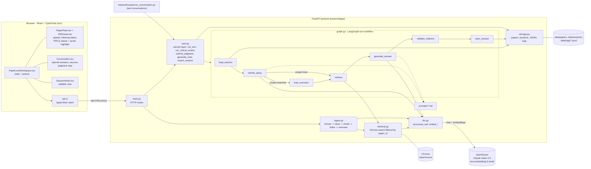

# PaperLens (CS3249 Assignment 2)

PaperLens helps university students read an academic paper through conversation. The learner uploads a
text-based PDF, picks a reading goal, asks questions, and gets short answers with expandable layers. Every
claim links to verifiable passages (PDF page + original text). If the goal is to explore research use, the
learner describes their research, runs a critical review, records **their own** verdict and rationale, and
gets an editable research-use note drafted from the real session.

The Assignment 1 prototype (scripted answers) is preserved on `master` / tag `a1-submission`. This branch
(`a2`) contains the working system.

---

## 1. Install and run

Requirements: Node 18+ (tested with 25.9), Python 3.13 (tested with 3.13.15), an OpenRouter API key.

```bash
# frontend dependencies
npm ci

# backend virtual environment (Windows paths; on macOS/Linux use .venv/bin/python)
cd backend
py -3.13 -m venv .venv
.venv/Scripts/python -m pip install -r requirements.lock.txt
copy .env.example .env        # then edit .env (see section 2)
cd ..
```

Start both processes in two terminals:

```bash
npm run backend    # FastAPI on http://127.0.0.1:8000  (scripts/backend.mjs -> uvicorn app.main:app --reload; restart after editing .env, or if a code change does not seem to apply)
npm start          # Vite dev server on http://127.0.0.1:5173, proxies /api to the backend
```

Open http://127.0.0.1:5173 and drop a PDF into the left pane. API docs: http://127.0.0.1:8000/docs.

Checks:

```bash
npm test               # local script tests (Node)
npm run test:backend   # backend offline tests (pytest; no API key needed)
npm run build          # typecheck + production build of the frontend
```

## 2. Models, APIs and configuration

All model calls go through **OpenRouter** (OpenAI-compatible API) with one key. Configuration lives in
`backend/.env` (template: `backend/.env.example`). Non-empty values in `.env` override system environment
variables. If `OPENROUTER_API_KEY` is already set as a system variable, it can stay empty in `.env`. The key is
never sent to the frontend and never written to logs.

| Setting | Default | Used for |
|---|---|---|
| `CHAT_MODEL` | `anthropic/claude-haiku-5.5` | query rewriting, answers, critical review, judgment feedback, overview, notes |
| `EMBEDDING_MODEL` | `openai/text-embedding-3-small` | chunk and query embeddings for retrieval |
| `OPENROUTER_BASE_URL` | `https://openrouter.ai/api/v1` | API endpoint |
| `PIPELINE_VERSION` | `v1` | `v0` = ablated baseline (see section 6) |
| `TOP_K`, `CHUNK_SIZE`, `CHUNK_OVERLAP` | 6, 1200, 200 | retrieval and chunking |

Structured replies use OpenRouter "structured outputs" (strict JSON schema from the Pydantic models in
`backend/app/schemas.py`). Prices at the time of writing (OpenRouter model list): Haiku 5.5 $0.10 / $0.50 per
million input/output tokens; text-embedding-3-small $0.02 per million tokens.

Libraries: FastAPI, LangGraph (turn workflow), LangChain (`langchain-openai` model clients,
`langchain-text-splitters` chunking), Chroma (local persistent vector store), pypdf (text extraction).
Exact versions: `backend/requirements.txt` (direct) and `backend/requirements.lock.txt` (all packages),
`package-lock.json` (frontend).

## 3. Architecture



**Two flows.**

1. **Ingestion** (once per PDF, background task): `ingest.run_ingestion` extracts text per page (pypdf),
   removes repeated headers/footers and page numbers, re-joins broken lines, and rejects PDFs without enough
   text. It then splits each page into overlapping chunks. Each chunk gets a stable ID
   `<paper8>-p<page>-c<n>` plus its `paper_id`, PDF page and printed page label. The chunks are embedded and
   stored in Chroma. Finally it writes overview summaries of consecutive page groups, each keeping its page
   range. Status: `queued -> parsing -> indexing -> summarizing -> ready | failed`.
2. **Turn** (every learner message, critical-review request and judgment): `core.run_turn` runs the
   LangGraph workflow above. It is a fixed retrieve-then-answer pipeline with one branch: whole-paper
   questions also receive the overview summaries.

**Session state** (`data/sessions/<id>.json`): paper ID, reading goal, research context, response language,
current concept, messages (with sources), PaperLens's suggestion (`system_suggestion`), the learner's own
`judgment` (verdict + rationale exactly as typed), and the note. The per-turn LangGraph state (`graph.TurnState`)
adds the retrieval query, scope, retrieved passages, overview items, raw model output and invalid citations.

## 4. One learner message, from input to reply

Example: the learner asked "What are the limitations of the Transformer?" and now types
**"Does that affect my study?"**

| # | Step | File and function |
|---|---|---|
| 1 | Enter in the composer submits the form | `src/components/Chrome.tsx` `Composer` -> `src/components/PaperLensWorkspace.tsx` `submit` -> `ask` |
| 2 | Show the message as pending, call the API | `PaperLensWorkspace.tsx` `runTurn` -> `src/api.ts` `api.sendMessage` (POST `/api/sessions/{id}/messages`, proxied by `vite.config.ts`) |
| 3 | HTTP route | `backend/app/main.py` `send_message` -> `backend/app/core.py` `run_turn` (validates input, streams the graph, logs) |
| 4 | Load stored state | `backend/app/graph.py` `load_session` (reads `data/sessions/<id>.json` via `storage.load_session`, checks the paper is `ready`) |
| 5 | Rewrite into a standalone query | `graph.rewrite_query`: prompt `prompts/rewrite.md` + `learner_context` + `format_history` -> `llm.structured_call(..., QueryRewrite)`. Result, e.g. *"Transformer limitations ... applicability to small-dataset sentiment classification on a single GPU"*, `scope=local` |
| 6 | Branch | `graph.route_by_scope` -> `retrieve` (or `load_overview` first for whole-paper questions) |
| 7 | Retrieve | `graph.retrieve` -> `backend/app/retrieval.py` `search` (`llm.embed_query`, then Chroma `query(where={"paper_id": ...})`, top 6). It also carries over the passages cited in the previous answer |
| 8 | Generate | `graph.generate_answer`: system prompt `prompts/answer.md` + `prompts/shared_rules.md`; user prompt = context + history + `<passage id=...>` blocks -> `llm.structured_call(..., AnswerPayload)` |
| 9 | Verify citations | `graph.validate_citations`: keeps only IDs provided this turn, attaches page/label/text from stored metadata, records invalid IDs, drops `system_suggestion` outside critical review, caps sections at 4. Each `evidence_quotes` entry is checked with `quotes.match_quote` against its cited passage; matches are attached to the source as `quotes`, failures are logged in `quote_checks` |
| 10 | Save | `graph.save_session` appends the user and assistant messages, updates the current concept (`storage.save_session`) |
| 11 | Log | `core.run_turn` writes one JSONL event (`graph.log_view` + model, prompt, pipeline version, config, latency, error) to `data/logs/<session>.jsonl` |
| 12 | Render | `runTurn` reloads the session (`api.session`) -> `src/components/Conversation.tsx` `AssistantBubble` (short answer, `RefChips`, `EvidenceNotice`, sections with kind labels, source list). Clicking a source -> `src/components/PaperPane.tsx` `PaperViewer` -> `PdfViewer.tsx` scrolls to the page, renders it with its text layer, and `highlight.locateOnPage` finds the verified quote; the matched words are highlighted on the page and the panel shows the quote |

If a model call fails, `run_turn` returns `{ok: false, error}` and logs it without changing the session. The UI
keeps the question and shows **Retry**.

## 5. Main components

| Path | Role |
|---|---|
| `src/components/PaperLensWorkspace.tsx` | Screen flow and all actions (upload, polling, session, turns, review, judgment, notes, export) |
| `src/components/PaperPane.tsx` | Upload card, indexing status with retry, cited-passage panel (quote, highlight status, summary page links) |
| `src/components/PdfViewer.tsx` | PDF.js viewer: lazy page rendering, text layer, zoom/fit, page navigation, highlight boxes |
| `src/highlight.ts` | Finds a cited quote in a page's text-layer items (exact, then anchored; never guesses); unit-tested in `highlight.test.ts` |
| `src/components/Conversation.tsx` | Layered answers, evidence notices, numbered sources, judgment step (verdict + own rationale) |
| `src/components/SessionNotes.tsx` | Research-use note: generated, editable, saved; learner judgment vs PaperLens suggestion shown separately |
| `src/components/Chrome.tsx` | Header (incl. log export), goal picker, research-context form, starter questions, composer, history, language |
| `src/api.ts` | Types and HTTP client |
| `src/i18n.ts` | Interface text in English, 简体中文, 繁體中文 and 日本語; display of stored values (verdicts, goals, request messages) |
| `src/styles/app.css`, `theme.css`, `a2.css` | A1 visual style + A2 additions |
| `backend/app/main.py` | REST API |
| `backend/app/core.py` | Single service layer used by the UI **and** test scripts |
| `backend/app/graph.py` | LangGraph turn workflow and citation validation |
| `backend/app/quotes.py` | Checks that each evidence quote occurs in its cited passage (word-level, small fuzziness) |
| `backend/app/ingest.py` | PDF -> pages -> chunks -> Chroma -> overview |
| `backend/app/retrieval.py`, `llm.py`, `storage.py`, `config.py`, `schemas.py` | Vector store, model clients, persistence, settings, output schemas |
| `backend/app/prompts/` | All prompts (versioned by `PROMPT_VERSION` in `config.py`) |
| `backend/scripts/run_conversation.py` | Runs scripted multi-turn conversations through `core.py` and saves full transcripts |
| `backend/tests/test_offline.py` | Tests for cleaning, chunking, scanned-PDF rejection and citation validation |
| `llm_judge/`, `red_team/`, `ai_logs/` | Folders and instructions for Assignment 2 Step 2 evidence |

### Language

* The **language setting** (globe icon, remembered in the browser, default English) sets both the interface
  language and the language PaperLens answers in. "PaperLens" and paper titles are not translated; quotes from
  the paper stay in the paper's language so they can be highlighted.
* An **explicit request in the chat** ("please answer in English from now on") is detected by the query-rewrite
  step (`language_request`, prompt p4; mapped by `graph.canonical_language`). For one of the four supported
  languages it changes the language setting itself, so the answers **and** the interface switch, and the
  frontend follows after the reply. For any other language only the answers switch, for the rest of the
  session (`session.language_override`); choosing a language in the settings clears it. Writing a message in
  another language is not treated as a request.
* Stored and logged values stay in English (verdicts, reading goals, the critical-review and judgment request
  texts); only their display is translated, so evaluation data is comparable across languages. Logs record
  `answer_language` and `language_override` for every turn. The downloaded note uses the interface language.

## 6. Logs, export and test support

* Every action writes a JSONL event to `backend/data/logs/<session_id>.jsonl`: session/paper IDs, user
  message, reply, retrieval query, retrieved chunk IDs + pages + text + similarity, raw model output, invalid
  citations, quote checks (each evidence quote: matched or not, reason, similarity), chat/embedding model,
  prompt version, pipeline version, config, timestamps, latency and errors. Internal reasoning is not logged.
* **Downloads** (download icon in the header):
  * *Research-use note (.md)*: the learner-facing note as Markdown (`GET /api/sessions/{id}/note.md`). The
    learner's decision and PaperLens's suggestion are separate sections. Also on the note page; unsaved edits
    are saved first.
  * *Session log (.json)*: paper metadata, session and all events, for evaluation (`GET /api/sessions/{id}/export`).
* **Deleting a session** (bin icon or right-click in Chat history, then confirm) is a soft delete: the session
  is hidden from the learner, but its file and JSONL log are kept and a `session_deleted` event is appended,
  so evaluation records are never lost (`DELETE /api/sessions/{id}`).
* **Scripted runs**: `backend/scripts/run_conversation.py` (see `llm_judge/README.md`).
* **`PIPELINE_VERSION=v0`** runs the same code with three safeguards off: no history-aware query rewriting, no
  overview routing, and no citation validation / suggestion guardrail. It is an *ablated baseline* for
  expected-fail conversations, not a historical build. Real development failures remain in the logs.

## 7. Known limitations

* Only PDFs with a text layer. Scanned PDFs are rejected with an explanation (no OCR). Figures, tables and
  equations are only available as whatever text pypdf extracts.
* Extraction quality depends on the PDF's fonts. Seen with real test papers: some ligature glyphs are dropped
  entirely by pypdf ("fields" becomes "felds", "effective" becomes "efective"), and a running header that does
  not repeat identically on most pages (e.g. author name plus page number) is not removed. Lone UTF-16
  surrogates (math italic letters) are rejoined or dropped by `ingest.safe_text`.
* Chunks never cross page boundaries, so a sentence split across two pages lands in two chunks.
* Highlighting needs a quote that passed the backend check and the same words in PDF.js's text layer. When the
  PDF.js text differs (dropped ligatures, odd spacing) the highlight is anchored on the quote's first/last words
  and labelled as approximate; answers from before prompt p3 have no quotes, so the start of the cited passage
  is highlighted instead; if nothing matches, the panel says the position was not found. The viewer renders
  pages lazily, so the browser's Ctrl+F only finds text on pages already rendered; the toolbar button opens the
  browser's own viewer for full search and printing. Page numbers are PDF page indexes ("PDF p. 3"); printed
  labels are shown only when the PDF defines them.
* A quote that passed the check only proves the words are in the cited passage, not that they support the
  answer's claim.
* Retrieval is single-shot (top 6 + up to 4 carried-over passages). If the relevant text is not retrieved,
  PaperLens says the passages found are insufficient; it does not search again.
* The overview is generated by the model. It is labelled as such in the UI, but it can contain summarisation
  errors.
* A valid citation ID only proves the passage was provided. Whether it supports the claim must be checked
  (Step 2).
* Local single-user system: no accounts or authentication, and data is stored as files under `backend/data/`.
  GitHub Pages deployment from A1 does not apply because a backend is required.
* DOI links are not resolved. Only direct PDF links and arXiv `/abs/` links are downloaded.

## 8. AI tool use

See `ai_logs/README.md`. Claude Code (VS Code extension) was used for planning and implementation; its
session transcript is to be exported into `ai_logs/`.
